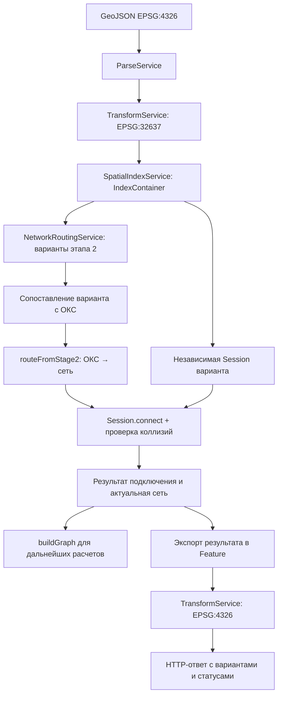

# Подключение этапа 3 к общему процессу

Этот файл описывает план интеграции существующего `ConnectionSelectionService`.
Приведенные ниже адаптеры и изменения оркестратора еще не внесены в Java-код.
Описание самого алгоритма и API находится в [README.md](README.md).

## 1. Текущее состояние

| Вход | Цепочка вызовов | Текущий результат |
| --- | --- | --- |
| `POST /routing/process-stage2` | `RoutingController` → `ProcessStage2RoutesService.buildRoutes` → этапы 1–2 → mapper → обратная проекция | Варианты этапа 2 по кластерам |
| `POST /routing/process` | `RoutingController` → `RoutingFlowService.buildRoute` → этап 1 | Пустой `FeatureCollection` |
| `POST /routing/process-json` | Та же цепочка `RoutingFlowService`, вход из тела запроса | Пустой `FeatureCollection` |

`DefaultRoutingCalculationService.calculate()` сейчас возвращает входную коллекцию,
а его вызов в `RoutingFlowService` закомментирован. Само внедрение bean этапа 3
не запускает расчет: его необходимо явно вызвать в оркестраторе.

## 2. Целевой порядок выполнения



Этап 3 вставляется **после** `executeRoutingPipeline(indexContainer)` и **до**
`RoutingResultToFeatureListMapper.map(...)` / `transform32637To4326(...)`.
Расстояние 10 м, буфер 2 м, проекция точки и разрезание считаются в метрической системе.
Преобразовывать геометрию обратно в WGS84 можно только после этих операций.

Потоки `Stream<Feature>` одноразовые: `buildSpatialIndices` уже потребляет входной поток.
Для этапа 3 используйте полученный `IndexContainer`. Если для ответа нужен исходный
набор объектов, материализуйте его отдельно до потребления потока.

## 3. Сначала определить единицу варианта

`executeRoutingPipeline` возвращает `List<List<stage2.model.RoutingResult>>`:
внешний список — кластеры, внутренний — альтернативы. Сейчас генератор этапа 2
создает один путь от сети к одному ОКС на `RoutingResult`; это не гарантия подключения
всех ОКС кластера. `RoutingResult` не содержит ни `oksId`, ни идентификатора кластера.

Для долговременного контракта добавьте явные `clusterId`, `variantId` и `oksId`
в DTO границы этапов либо в обертку результата. Не связывайте ОКС с вариантом
по позиции в списке: пути сортируются по весу.

Для текущего кода допустим временный адаптер: после разворота трассы ее первая
координата должна точно совпасть с `connectionPoint` ровно одного ОКС.
Если совпадений нет или больше одного, верните ошибку сопоставления;
не выбирайте произвольный ближайший объект.

## 4. Пример обработки одного варианта

Ниже — методы для нового оркестратора. Зависимости `connectionSelectionService`
и `collisionDetectionService` передаются через конструктор Spring-сервиса.
В примере используются `stage2.model.RoutingResult`, `IndexContainer`, `OksObject`,
`stage3.ConnectionResult`, `dto.Feature`, классы JTS и стандартные коллекции Java.

```java
private OksObject resolveOks(LineString route, IndexContainer indices) {
    List<OksObject> matches = indices.getOksObjects().stream()
        .filter(oks -> oks.getConnectionPoint() != null)
        .filter(oks -> !oks.getConnectionPoint().isEmpty())
        .filter(oks -> oks.getConnectionPoint().getCoordinate()
            .equals2D(route.getCoordinateN(0)))
        .collect(java.util.stream.Collectors.toList());
    if (matches.size() != 1) {
        throw new IllegalArgumentException("Невозможно однозначно определить ОКС");
    }
    return matches.get(0);
}

private boolean isPassable(
        LineString adjusted, IndexContainer indices, OksObject oks) {
    Envelope envelope = new Envelope(adjusted.getEnvelopeInternal());
    envelope.expandBy(2.0); // Радиус буфера CollisionDetectionService
    List<Geometry> constraints = new ArrayList<>();
    for (Object item : indices.getConstraintsTree().query(envelope)) {
        // SpatialIndexService помещает в этот индекс именно Feature.
        Feature feature = (Feature) item;
        constraints.add(feature.getGeometry());
    }
    return collisionDetectionService.isSegmentPassable(
        adjusted, constraints, List.of(oks));
}

private ConnectionResult processVariant(
        RoutingResult variant, IndexContainer indices) {
    LineString route = connectionSelectionService.routeFromStage2(variant);
    OksObject oks = resolveOks(route, indices);
    if (oks.getBuildingPolygon() == null) {
        throw new IllegalArgumentException("У ОКС отсутствует полигон здания");
    }
    var session = connectionSelectionService.newSession(indices);
    ConnectionResult connection = session.connect(
        oks.getId(), route, adjusted -> isPassable(adjusted, indices, oks));

    // Для следующего расчетного этапа сохраните вместе с connection:
    // session.buildGraph() и снимок session.getSegments().
    return connection;
}
```

`CollisionDetectionService` обращается к полигону ОКС при проверке исключения
для собственного здания; поэтому пример явно проверяет наличие полигона.
Выборка ограничений строится по **исправленной** трассе на каждом вызове предиката:
новый конечный участок может выйти за исходное окно маршрута.

В примере валидируется вся линия. У существующего `CollisionDetectionService`
исключение для собственного здания применяется ко всему переданному сегменту,
если он касается `connectionPoint`. Для более строгой интеграции проверяйте
составляющие отрезки исправленной трассы отдельно: тогда освобождение от проверки
собственного здания относится только к отрезку, заходящему в ОКС.
Это правило нужно согласовать с принятой моделью коллизий этапа 2.

## 5. Сессии, альтернативы и отказы

Для независимых альтернатив создавайте новую сессию **внутри** цикла вариантов.
Если передать все альтернативы в одну сессию, они начнут расходовать доступные
подключения камер и разрезать трубы друг для друга.

Для совместно реализуемого решения нескольких ОКС, в том числе из разных кластеров,
создайте одну сессию и последовательно вызывайте `connect`. Зафиксируйте порядок
обработки ОКС: предыдущие подключения влияют на следующие. Независимые успешные
расчеты по кластерам сами по себе не доказывают допустимость их объединения.

Правила обработки на уровне оркестратора:

1. `connected == false` этапа 2 сохраняйте как неподключенный вариант; `connect` не вызывайте.
2. Ошибку сопоставления ОКС или геометрии сохраняйте отдельно от невозможности врезки.
3. `IllegalStateException` при `connect` превращайте в отказ конкретного варианта
   с причиной, затем продолжайте независимые альтернативы.
4. Если составной вариант требует подключения всех ОКС, при отказе одного ОКС
   отбросьте его сессию целиком. Успешные предыдущие подключения не откатываются.
5. Если отбор вариантов использует длину и штрафы поворотов, пересчитайте их после
   изменения конца трассы: прежнее ранжирование этапа 2 может стать неактуальным.

В текущих HTTP DTO нет подробного контракта отказов этапа 3. Предлагаемая обертка
варианта: `clusterId`, `variantId`, `oksId`, `status`, `reason`, результат GeoJSON
и описание изменений существующей сети. Эти поля необходимо добавить явно;
они не появляются в ответе автоматически.

## 6. Экспорт и передача топологии дальше

`RoutingResultToFeatureListMapper` этапа 2 экспортирует геометрии с `properties = null`.
Для этапа 3 нужен отдельный mapper, сохраняющий идентификаторы и назначение объектов.

| Источник | Что передавать |
| --- | --- |
| `connection.route` | Исправленная новая труба, `object_type = heat_network`, `oks_id` |
| `connection.chamber` | Камера, `object_type = heat_chamber`, ее `id` и координаты |
| `connection.replacedSegment` | Идентификатор удаляемого участка, если он не `null` |
| `connection.createdSegments` | Новые участки вместо удаленного, их `id`, диаметр и происхождение |
| `session.getSegments()` | Итоговое состояние существующей сети после всех врезок |
| `session.buildGraph()` | Граф в метрической проекции для последующих расчетов |

Для ответа выберите один из двух контрактов:

- **Снимок**: итоговые участки из `getSegments()` плюс новые трассы и камеры.
- **Изменения**: новые трассы/камеры, удаляемые идентификаторы и заменяющие участки.

Во втором случае при нескольких врезках изменения нужно применять в порядке
вызовов: сегмент, созданный первой операцией, может быть заменен второй.
Нельзя просто объединить все `createdSegments` — в ответ попадут промежуточные трубы.
Камеры нескольких подключений дедуплицируйте по идентификатору.

`FeatureProperties` уже содержит `id`, `objectType`, `diameter`, `oksId`, но не содержит
`parentId`, `virtual`, `connectionType` и списка удаляемых ID. Для передачи этих данных
расширьте DTO или используйте отдельную обертку изменений. `upstreamObjectId` имеет
другую семантику; не подменяйте им `parentId` без изменения контракта.
Диаметр новой трассы этап 3 не рассчитывает; не копируйте его из трубы врезки автоматически.

При создании `Feature` задавайте `GeoJsonType.FEATURE` и копируйте геометрию:

```java
FeatureProperties properties = new FeatureProperties();
properties.setId("route-" + java.util.UUID.randomUUID());
properties.setObjectType(ObjectType.HEAT_NETWORK);
properties.setOksId(connection.getOksId());
Feature routeFeature = new Feature(
    connection.getRoute().copy(), properties, GeoJsonType.FEATURE);
```

Затем передайте **экспортные копии** в `transform32637To4326` и соберите поток
в список для `FeatureCollection`. Состояние сессии и граф оставьте в EPSG:32637.
Для полного снимка нужно также сохранить исходные камеры: у `Session` нет публичного
метода выдачи всех узлов, а результаты подключений содержат только задействованные.

## 7. Какие файлы менять при внедрении

| Файл или компонент | Необходимая работа |
| --- | --- |
| `stage2/model/RoutingResult.java` или новая обертка | Явная связь пути с ОКС и вариантом |
| Новый оркестратор этапов 1–3 | Вызовы сервисов, сессии, статусы отказов, сбор результатов |
| Новый mapper этапа 3 | Экспорт камер, трасс и изменений сети с метаданными |
| DTO HTTP-ответа | Варианты, статусы, идентификаторы и контракт изменений |
| `service/RoutingFlowService.java` | Заменить пустой ответ делегированием оркестратору |
| `controller/RoutingController.java` | Согласовать тип ответа основных endpoints с новым DTO |
| `stage2_test/ProcessStage2RoutesService.java` | При необходимости использовать как образец цепочки; диагностический endpoint этапа 2 можно сохранить |

Не запускайте этапы 1–2 повторно внутри каждого варианта: индексы и результаты
этапа 2 рассчитываются один раз на запрос. Сессии этапа 3 создаются на варианты.

## 8. Проверка интеграции

Текущие модульные тесты алгоритма:

```bash
mvn -f backend/pom.xml -Dtest=ConnectionSelectionServiceTest test
```

После подключения добавьте проверки общей цепочки:

1. GeoJSON проходит преобразования 4326 → 32637 → 4326; расстояния считаются в метрах.
2. Путь сопоставляется с нужным ОКС, его начало не перемещается при выборе камеры.
3. Новое положение конца повторно проверяется на ограничения за исходным окном трассы.
4. Альтернативы изолированы; совместные подключения учитывают общий лимит камеры.
5. В снимке разрезанная труба заменена итоговыми сегментами без промежуточных дублей.
6. При отказе одного варианта остальные возвращаются с корректными статусами.
7. HTTP-ответ сохраняет идентификаторы и метаданные, а исходные индексы остаются метрическими.

Эти проверки интеграции — план для будущего внедрения. Существующие семь тестов
проверяют сервис этапа 3, а не завершенный HTTP-процесс этапов 1–3.
