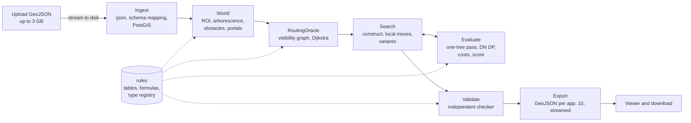

# 3. High-level implementation plan

Builds on [01-spec-analysis.md](01-spec-analysis.md); assumptions referenced as Qn are in [02-open-questions.md](02-open-questions.md). Updated 2026-09-16 for the sample dataset.

## 3.0 Principles

1. **One tree.** Existing and new network are one arborescence rooted at the source. Flows, diameters, reconstruction, chambers, and costs come from a single bottom-up pass.
2. **Rules are data.** Every table, formula, clearance, and crossing rule lives in one declarative module. The optimiser and the validator both read it; neither hardcodes a number.
3. **Exact evaluation everywhere.** The search never reasons with a proxy it cannot verify. Every candidate plan is priced by the same evaluator that prices the final answer.
4. **Pure core, thin shell.** The routing core is a framework-free library with an in-memory world. The service adds upload, storage, jobs, and export. The CLI runs the core on a file, which is what tests and the demo dataset use.
5. **Nothing dataset-specific.** Every threshold is a named parameter with the spec's value as default. Generality is tested by running the same code on a transformed copy of the dataset and on a synthetic district.
6. **Trust nothing you produced.** An independent validator re-derives every rule and every cost from the exported GeoJSON.
7. **Derive, then declare.** Ingest maps whichever schema arrives (appendix or sample) onto one canonical model. Every derived value is tagged, and the run report separates measured from assumed.

## 3.1 Architecture

Containers: `db` (PostGIS), `api` (FastAPI, also serves the static viewer), `worker` (same image, runs jobs). Nothing else.

Core package, one responsibility per module:

| Module | Responsibility |
|---|---|
| `rules` | Tables 4.1 to 4.3, restriction rules 5.1 as a type registry with aliases (`oks`, `railway`, unknown), formulas of sections 6 to 9, output schema of section 10. Data plus tiny pure functions. |
| `ingest` | Streaming GeoJSON parser, schema mapping onto the canonical model (appendix and sample shapes), CRS transform, load into PostGIS, dataset diagnostics. Unknown properties such as `address` and `name` are kept as JSONB and never exported. |
| `world` | Per-run in-memory model in EPSG:32637: region of interest, existing arborescence, obstacle model, portals, terminals with entry portals, tie-in candidates. |
| `routing` | `RoutingOracle`: legal shortest paths between points, with per-piece attributes; cached one-to-all distances; dynamic obstacle masks. |
| `network` | The combined arborescence and its evaluation: flows, DN assignment, reconstruction, chambers, technical nodes, costs, score. |
| `search` | Plans, constructive heuristic, local moves, repairs, variant selection, unrouted policy. |
| `export` | GeoJSON writer for appendix 10, id scheme, summaries, run report of derived values. |
| `validate` | Independent rule checker and cost re-computation; compliance report. |
| `service` | API, job queue, storage, streaming upload and export, viewer. |
| `cli` | `route <input.geojson> [--mode 2d|depth] [--params ...]` end to end. |

## 3.2 Core algorithms

### Canonical model (ingest)

Four derivations turn either schema into one model. Each returns a value plus a provenance flag (`given` or `derived`) that the run report prints.

- **Topology.** If `upstream_object_id` is present and consistent, use it. Otherwise snap section endpoints and chamber points with a 0.5 m tolerance, build the undirected graph, and orient every edge by breadth-first search from the node nearest the source (Q2). Cycles become a shortest-path arborescence with a diagnostic; disconnected components each need a source or are reported (Q29).
- **Chamber DN.** Given, else the maximum DN of adjoining sections, which is the appendix's own definition.
- **Existing flow.** Given, else the `existing_flow_policy` parameter: `zero` (default), or a fraction of capacity (Q3). Headroom follows.
- **Host building.** `oks_future` polygon linked by `oks_id` if present, else the obstacle polygon containing the connection point, else the nearest within 1 m, else none (Q5, Q6).

### World

- **CRS.** Everything internal is EPSG:32637. Transform on ingest and export only.
- **Region of interest.** Convex hull of the connection points and of the existing network within radius R of them, buffered by margin M. Obstacles outside are never loaded. The existing network outside the ROI is kept only as the upstream chain (ids, lengths, DNs, flows) for reconstruction. The sample's ROI is 0.9 km² with 51 buildings.
- **Existing arborescence.** From the canonical model. Each edge carries `headroom = capacity(DN) − flow`. Diagnostics: gaps, dangling ends, cycles, off-table DN, pre-overloaded sections, non-monotone DN toward the source (Q28), chambers at their degree limit. Micro-sections (the sample has thirteen of 2 to 10 m) stay as edges so reconstruction portions can reference their original ids.
- **Obstacle model.** Prohibited objects become inflated polygons: geometry buffered by clearance plus half the pipe-pair design width, mitre joins, simplified outline (Q10). Crossable objects produce two shapes: the no-go band (clearance buffer) and the special zone (polygon plus 3 m for road, tram, and by assumption railway; 2 m either side of the crossing point for lines). The type registry maps `restriction_type` to a rule; unknown types are prohibited with 1 m clearance and a diagnostic (Q27).
- **Portals.** For road, tram, and railway polygons: candidate straight crossing segments spanning the special zone at angles of at least 45° to the local boundary, spaced every P metres and at projections of nearby terminals (Q8). For lines: any edge may cross; the special piece is carved out of the edge at the crossing point.
- **Terminal entry.** A connection point inside its host building is reached through entry portals: points on the host outline visible from the terminal through the interior, connected to the terminal by a straight in-building edge priced as ordinary pipe times a parameter `k_inside` (default 1). The host is not inflated for its own terminal; it stays a full obstacle for every other path. A terminal or tie-in candidate inside another object's inflated zone gets a gate, the nearest free-space point, with the approach segment exempt and reported (Q5).
- **Tie-in candidates.** Every existing chamber in the ROI with spare degree; points along sections every s metres plus foot points of terminals; candidates within 10 m of a chamber collapse into that chamber. Each candidate knows its existing object, split chainage, chamber-or-new status, spare degree, and upstream chain.

### RoutingOracle

- **Vertices.** Reflex corners of inflated obstacles, portal endpoints (crossings and building entries), gates, tie-in candidates.
- **Edges.** Pairs with clear line of sight against inflated obstacles, respecting the alongside rule for linear restrictions (Q9) and the angle rule where an edge crosses a road, tram, or railway polygon. An edge is a list of pieces, each `base`, `special`, or `inside` with the object id.
- **Metric.** Effective length: each piece's length times an inflation factor derived from `K_special` at the group's reference DN and from λ. The oracle stays DN-agnostic; the evaluator prices the actual DN. This is safe because DN is nearly constant along a path and the factors are close to 1.
- **Queries.** Shortest path between two vertices or arbitrary points; one-to-all Dijkstra from every terminal, cached for the run. A path object carries its pieces and turn points.
- **Masks.** Sections already built by other trees are extra obstacles for later queries, so trees cannot cross each other.
- **Scale.** ROI clipping, reflex-vertex reduction, radius-limited candidate edges, vectorised STRtree intersection tests. The sample's 4 900 outline vertices reduce to a few thousand graph vertices; a lazily explored any-angle A* on a grid, using the same line-of-sight primitive, sits behind the same interface as the fallback for city-scale files.
- **DN classes.** The 5 / 7 / 9 m clearance for existing OKS depends on DN. The oracle is built for the class implied by the largest flow any tree can carry (the sample's 489 t/h total stays below DN500), and re-validated after DN assignment.

### Plan and evaluation

A plan is a list of groups. A group is a terminal set, a tie-in candidate, and a topology: oracle paths joined at branch vertices.

`evaluate(plan)` builds the combined arborescence and runs one bottom-up pass:

1. Added flow per edge (sum of OKS flows below), total flow, required DN.
2. Existing edges: reconstruction portions where DN_req exceeds DN, split at tie-in chainages (appendix 7).
3. New edges: DN assignment with the maximum-length rule (Q7). Lazy upgrade from the leaves, DN non-increasing away from the tie-in, run budget at a branch equal to the maximum used length among children at the same DN. Technical nodes are placed at exact chainages where the DN changes.
4. Node typing: tie-in, chamber (every node with more than one child, plus tie-ins), technical node (every remaining parameter change), terminal. Degree checks at chambers including existing sections.
5. Chamber tiers from the maximum adjoining DN including post-reconstruction DNs (Q12); existing tie-in chambers reconstructed once when exceeded.
6. Costs by section, chamber, tie-in, reconstruction, penalty; C, L, and S.

The result is an `Evaluation` with a full breakdown and a list of violations, so the search can compare infeasible neighbours by penalised score while still knowing they are infeasible.

### Search

- **Construct.** Each OKS alone, tied to the best of its top-k candidates by exact evaluation. Then greedy agglomeration: repeatedly apply the best score-improving merge of two groups. A merged topology is built by the shortest-path heuristic from a re-chosen tie-in (attach the nearest unattached terminal via its cached shortest path to the current tree); branch points are graph vertices; a path that crosses the tree it is joining attaches at the crossing instead.
- **Improve.** First-improvement local search with a few seeded restarts. Moves: re-tie a group; move an OKS between groups; split a group; merge two groups; relocate a branch chamber toward the Fermat point of its neighbours while visibility holds; reroute a path through an alternative portal. Repairs: a chamber over degree 4 gets a second chamber a few metres down one branch; a cross-tree crossing is resolved by merging the trees or by rerouting with a mask, whichever scores better.
- **Variants.** Keep the best plan per signature, where a signature is the set of tie-in objects and the partition of OKS into components. Option 1 is the global best. Option 2 is the best with option 1's tie-in set forbidden. Option 3 is the best with option 1's partition forbidden. Rank all by S (Q16).
- **Unrouted OKS.** A terminal with no entry, no reachable candidate, or no feasible plan is unrouted with a stated reason; the penalty applies; nothing else in the option is affected (spec 2.9). Connection is mandatory whenever feasible (Q14).
- **Determinism.** Fixed seed; identical output for identical input.
- **Expected behaviour on the sample.** Under the zero-flow policy the search should carry roughly 50 t/h north to the DN500 head or reconstruct part of the DN300 stretch, and group the three western clusters into shared trunks. If it does neither, the evaluator or the candidates are wrong, which makes the sample a strong first fixture.

### Export and validate

- Ids follow `{variant}-{type}-{seq}`; references to input objects echo the input id as given (Q30); coordinates go back to EPSG:4326 with eight decimals; every feature carries exactly its own attribute set from appendix 10; one summary per variant; a run report lists derived values and diagnostics.
- The validator parses input and output afresh, rebuilds each option's tree, checks every hard rule in analysis 1.4, and recomputes every cost, length, and score through code that shares only the `rules` tables with the evaluator. Its compliance report is used in tests, in CI, and in the viewer.

## 3.3 Service

- **API** (OpenAPI 3, Swagger UI, Q19): `POST /datasets` (multipart, streamed to disk, ingest job), `GET /datasets/{id}` (status, diagnostics, derived values), `POST /runs` (`dataset_id`, `mode` 2d or depth, parameters including the existing-flow policy), `GET /runs/{id}` (status, progress, log), `GET /runs/{id}/result.geojson` (streamed), `GET /runs/{id}/summary`, `GET /runs/{id}/compliance`.
- **Jobs.** PostgreSQL-backed queue using `SELECT ... FOR UPDATE SKIP LOCKED`; N worker processes; a small state machine with cancellation. No broker, no cache server (Q22).
- **Storage.** Tables `datasets`, `features` (geometry with a GIST index, `object_type`, JSONB properties), `runs`, `result_features`, `diagnostics`. Export streams rows into a FeatureCollection writer; nothing is materialised in memory.
- **Streaming.** `ijson` over the `features` array, COPY in batches, temporary file on disk. 3 GB in and 500 MB out never load whole (Q21).
- **Viewer.** One static page on MapLibre GL or Leaflet: layers per variant and object type, click for attributes, compliance panel, unrouted list, reconstruction highlights, derived-value report. It exists to serve the demonstration list in spec 4.
- **Compose.** `db` on `postgis/postgis:16-3.4` (Q20), `api`, `worker`; volumes for uploads and data; compose-file 3.8 syntax that runs under both `docker-compose` 1.29.2 and compose v2 (Q23).

## 3.4 Stack

Python 3.12; `shapely` 2 (GEOS, vectorised STRtree), `pyproj`, `numpy`, `scipy.sparse.csgraph` for Dijkstra, `networkx` for small trees, `ijson`, `fastapi` and `uvicorn`, `psycopg` 3, `pydantic`; `pytest` and `hypothesis`; `ruff` and `mypy`. The profiling scripts written on 2026-09-16 already run on this stack.

Why not Java: GEOS is JTS with vectorised bindings, the geometry-heavy iteration loop is fastest in Python, and the framework-free core runs in notebooks for debugging. If Java is reinstated the design is unchanged: JTS, JGraphT, and Spring Boot replace the bindings in `routing` and `service` only.

## 3.5 Phases

| Phase | Deliverable | Exit criterion |
|---|---|---|
| 0. Codify and reconnoitre | `rules` with tests against the appendix numbers; canonical-model ingest with both schemas; diagnostics report on the sample (done 2026-09-16 as analysis 1.3, to be reproduced by the ingest module); questions sent | Ingest reproduces the sample report; rules tests green |
| 1. Legal paths | `world`, `routing`, CLI that connects every OKS individually to its nearest legal tie-in; raw GeoJSON export; viewer v0 | Every sample OKS has a legal path into its building, or a stated reason. This is the interim submission (spec 7.1) |
| 2. Correct networks | `network` evaluator, full appendix 10 export, `validate` | An all-separate, single-option solution for the sample passes the validator |
| 3. Optimisation | Candidates, agglomeration, local search, repairs, variants, unrouted policy | Three options on the sample and on a perturbed copy, validator-clean, with the expected behaviour above |
| 4. Service (parallel from phase 2) | Streaming ingest, jobs, API, compose, viewer v1 | Upload, run, and export work in the browser |
| 5. Hardening and delivery | Generality tests, performance, documentation (spec 5), presentation (spec 4), exported result | Final submission (spec 7.2) |
| 6. Depth mode (optional) | Section 3.8 | Separate depth run passes an extended validator |

Durations depend on Q24. Phases 0 to 2 are sequential and small; phases 3 and 4 run in parallel; phase 5 needs at least a week.

## 3.6 Testing and quality

- **Rules.** Unit tests for table lookups, tiers, penalty, and score against hand-computed values (the appendix example is not internally consistent, so it is not a fixture).
- **Schemas.** The same synthetic world serialised in the appendix shape and in the sample shape must produce identical canonical models, with provenance flags differing.
- **The sample.** First fixture for every phase: 17 connected, entries through host outlines, tie-ins split between the DN500 head and the DN300 stretch, reconstruction only where the 437 t/h cap forces it under the zero-flow policy.
- **Scenarios.** Tiny synthetic worlds with known answers: straight shot; around a park; road crossing with angle; alongside a gas line; two neighbours where joint is cheaper and two distant OKS where separate is cheaper; tie-in within 10 m of a chamber; chamber at its degree limit; maximum length forcing a DN upgrade with a technical node; mid-section tie-in reconstruction; two tie-ins on one chain with summed flows; an unreachable OKS; a terminal deep inside a building.
- **Properties.** On random worlds: output is a forest, one tie-in per component, no crossings, degree ≤ 4, clearances hold, run lengths hold, validator costs equal evaluator costs.
- **Generality.** The sample with shifted, rotated, and mirrored coordinates and renamed ids gives the same structure; a second synthetic district runs without code changes.
- **Determinism and performance.** Fixed seed gives byte-identical output; run time and memory are tracked per phase against a 16 GB budget.

## 3.7 Risks

| Risk | Impact | Mitigation |
|---|---|---|
| Rule ambiguities (Q3, Q7, Q8, Q14) resolved late | Wrong optimum, rework | Every assumption is a parameter; questions sent in phase 0 |
| Schema drift between the sample and the final dataset (Q26) | Ingest fails on day one | Canonical model with both shapes under test; provenance flags; unknown types and attributes never fatal |
| Visibility graph too large for a city-scale ROI | Slow or infeasible runs | ROI clipping, reflex reduction, radius limits, any-angle fallback behind the same interface |
| Dirty topology in the hidden dataset | Wrong reconstruction chains | Tolerant builder with diagnostics; generality tests on perturbed data |
| Paths crossing each other or other trees | Invalid output | Repairs inside the search loop; validator gate before export |
| Terminals inside buildings or clearance zones | Many unrouted OKS | Entry portals and gates with reported clearance (Q5) |
| Optimiser tuned to one dataset | Poor result on the second dataset | No dataset constants; synthetic and perturbed tests; seeded restarts |
| Timeline unknown (Q24) | Scope overrun | Phases ordered by mandatory value; depth mode last and optional |

## 3.8 Depth mode (optional)

The 2D machinery stays; depth is a profile problem on the finished tree.

- **Levels.** Depths in 0.5 m steps within the configured range; ordinary 3.0 m; minimum 0.7 m.
- **Constraints per crossing.** From appendix 4.3 and 5.1: allowed depth intervals above or below each crossed utility with the required vertical gap; road, tram, and railway require the top at least 1.0 or 1.2 m below ground; a 4 m flat section at line crossings; ramps at most 0.10 m/m.
- **Profile DP.** Chainage along each edge is discretised at crossing zones and ramp lengths. A tree DP over node depths (continuity at chambers and technical nodes) with a 1D shortest path per edge chooses above or below and the ramp positions. Cost uses `K_depth`, the average on ramps, and a technical node where a ramp crosses 3.0 m.
- **Feedback to the plan.** Each crossing's cheapest vertical cost is added to the corresponding portal or crossing weight in the oracle, so the plan route can change when depth makes a crossing expensive (appendix A.1).
- **Output.** Z on every new geometry, `depth_start` and `depth_end`, crossing records with above or below and the achieved clearance, and manual-review flags where no profile fits the depth range.
